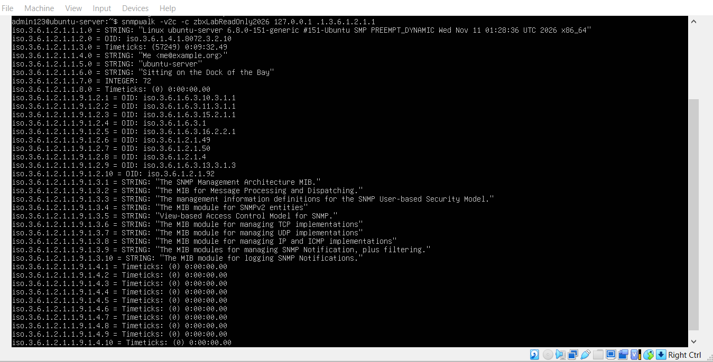
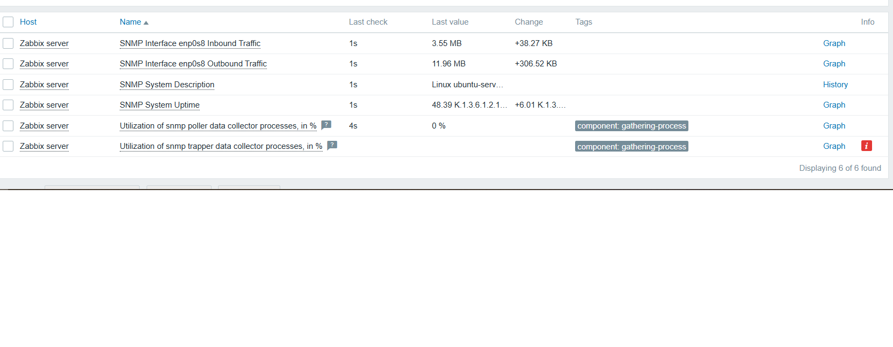
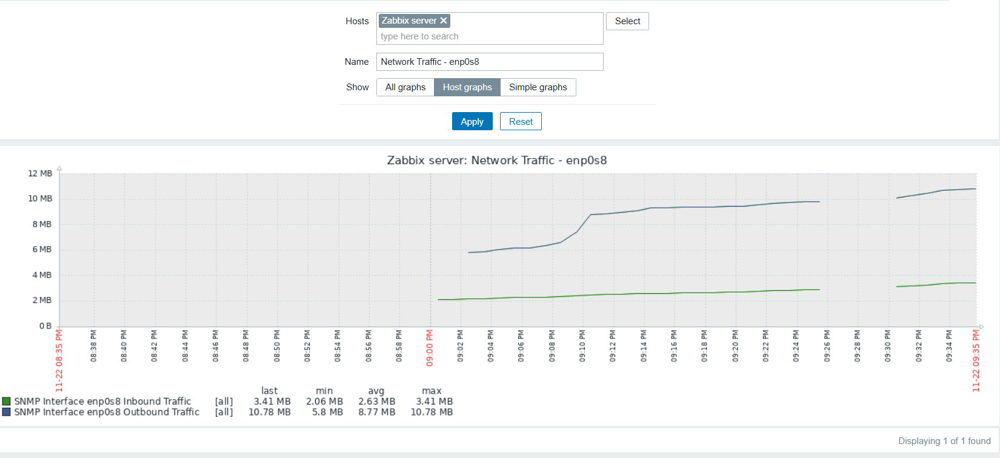
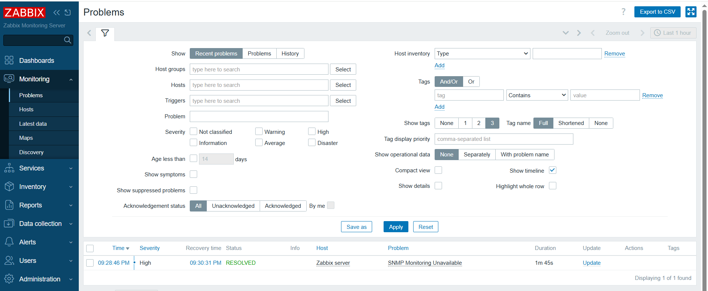

# Network Monitoring & Fault Detection Using Zabbix

## Project Overview

This project demonstrates a Linux-based network monitoring and fault-detection environment built using **Zabbix 7.0.32**, **Ubuntu Server 24.04 LTS**, and **SNMPv2c**.

The objective was to configure monitoring for a Linux server, collect system and network interface information through SNMP, visualize network traffic, and configure automated triggers to detect monitoring failures.

The project also includes a controlled SNMP service outage test to verify problem detection and automatic recovery.

## Technologies & Tools

- Ubuntu Server 24.04.5 LTS
- Zabbix 7.0.32
- MySQL
- Apache
- SNMPv2c
- Zabbix Agent
- Oracle VirtualBox
- Windows Host Machine

## Lab Environment

| Component | Configuration |
|---|---|
| Virtualization | Oracle VirtualBox |
| Operating System | Ubuntu Server 24.04.5 LTS |
| Monitoring Platform | Zabbix 7.0.32 |
| Database | MySQL |
| Web Server | Apache |
| RAM | 4 GB |
| CPU | 2 Cores |
| Virtual Disk | 40 GB |
| Network Adapter 1 | NAT |
| Network Adapter 2 | Host-only |
| Host-only IP | 192.168.56.103 |

Zabbix Web Interface:

`http://192.168.56.103/zabbix`

## Project Implementation

### 1. Zabbix Server Installation

Installed and configured Zabbix Server 7.0.32 on Ubuntu Server.

Configured:
- MySQL database
- Zabbix Server
- Zabbix Frontend
- Apache web server
- Zabbix Agent

Verified that the Zabbix Server service was running successfully.

### 2. SNMP Configuration

Installed SNMP packages and configured the SNMP daemon (`snmpd`).

Implemented:
- SNMPv2c
- Read-only community access
- Localhost-only SNMP access
- SNMP system information retrieval

Used `snmpwalk` to verify SNMP communication and retrieve system information through numeric OIDs.

### 3. Custom SNMP Monitoring Items

Created four custom SNMP items on the Zabbix host.

| Monitoring Item | SNMP OID |
|---|---|
| SNMP System Description | `.1.3.6.1.2.1.1.1.0` |
| SNMP System Uptime | `.1.3.6.1.2.1.1.3.0` |
| Interface enp0s8 Inbound Traffic | `.1.3.6.1.2.1.31.1.1.1.6.3` |
| Interface enp0s8 Outbound Traffic | `.1.3.6.1.2.1.31.1.1.1.10.3` |

Verified that Zabbix successfully collected SNMP system information and interface traffic counters.

### 4. Network Traffic Graph

Created a custom Zabbix graph named:

`Network Traffic - enp0s8`

The graph combines:
- Inbound interface traffic counter
- Outbound interface traffic counter

This provides a visual representation of the collected interface traffic data.

### 5. Trigger Configuration

Created a custom trigger:

**SNMP Monitoring Unavailable**

Configuration:
- Monitoring Item: SNMP System Uptime
- Function: `nodata()`
- Detection Period: 3 minutes
- Condition: No data received for the configured period
- Severity: High

Trigger expression:

```text
nodata(/Zabbix server/snmp.system.uptime,3m)=1
```

The trigger generates a problem event when SNMP monitoring data is unavailable for three minutes.

### 6. Fault Detection & Recovery Testing

Performed a controlled failure simulation by stopping the SNMP service:

```bash
sudo systemctl stop snmpd
```

After the configured detection period, Zabbix generated a High-severity problem event.

Restarted the SNMP service:

```bash
sudo systemctl start snmpd
```

Zabbix resumed receiving SNMP data and automatically resolved the problem.

**Test Result:** Successful problem detection and automatic recovery verification.

## Screenshots & Verification

### SNMP Agent Verification



### Latest Data - SNMP Monitoring Items



### Network Traffic Graph



### Trigger Recovery Verification



## Skills Demonstrated

- Linux server administration
- Zabbix installation and configuration
- Network monitoring
- SNMPv2c configuration and troubleshooting
- SNMP OID identification
- Custom monitoring item creation
- Network traffic visualization
- Trigger and problem configuration
- Fault detection and recovery verification
- Virtual machine networking
- Basic monitoring and troubleshooting

## Conclusion

This project demonstrates the implementation of a functional network monitoring lab using Zabbix and SNMP.

It covers server monitoring, network interface traffic collection, custom trigger configuration, controlled fault simulation, and automated recovery detection.

**Author:** Abdul Rahman

**GitHub:** https://github.com/arahmann

**LinkedIn:** https://linkedin.com/in/abdul-rahman12
